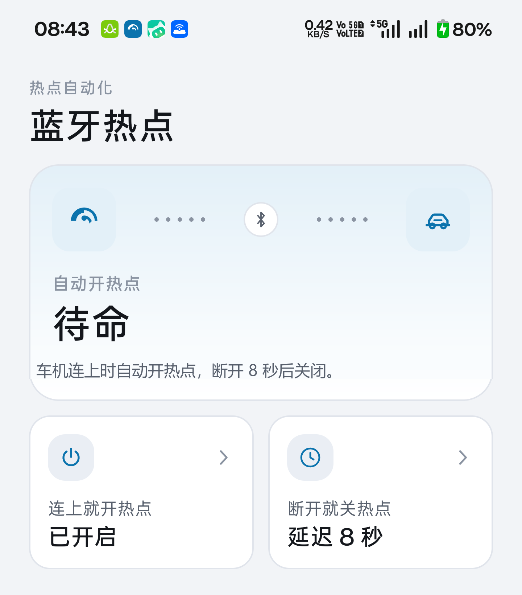
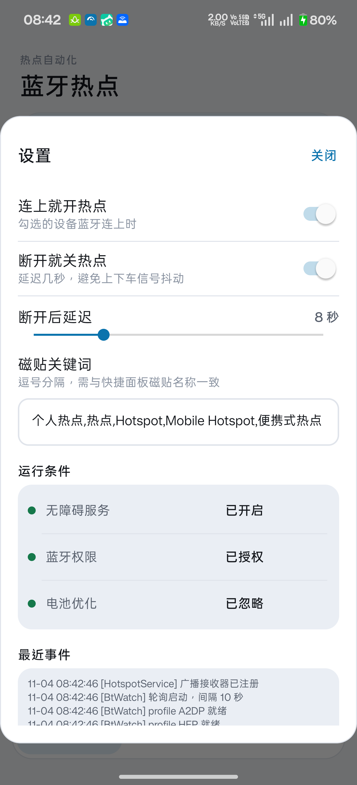

# 热点自动化 · HotspotAuto

**车机蓝牙连上 → 自动开热点；断开 → 自动关热点。免 root、免 Shizuku。**

纯 Java、零第三方依赖（不用 AndroidX），命令行一条 `./build.sh` 直接出 APK，体积 76 KB。

> ### ⚠️ 这是自用项目，只按一台手机适配
>
> **开发环境：一加 12（CPH2573）/ OxygenOS 16 / Android 16。**
>
> 磁贴关键词、控件节点结构、点击方式，全部是照着这台机器实际的快捷面板调出来的。
> 换到其它机型，大概率**找不到磁贴，或者点了没反应**——不是配置问题，是界面结构不同。
>
> 没有在其它任何手机、其它任何 ROM 上验证过，**不保证可用**。
> 想移植的话，要动的是 `TileAccessibilityService.findTile()` 和设置里的「磁贴关键词」，
> 先用 `adb shell uiautomator dump` 看清你自己机器上热点磁贴长什么样。



## 为什么非要"点磁贴"

Android 16 起，普通应用已经拿不到开关热点的能力了——`TetheringManager.startTethering()`
需要系统签名权限，第三方应用调用直接被拒。

免 root 只剩一条路：**用无障碍服务代替人手**。展开快捷设置面板，找到「个人热点」磁贴，
点一下。行为上跟用户手动操作完全等价，所以系统拦不住，也不需要任何特权。

代价是每次操作会闪一下面板，以及依赖磁贴的名字和位置。这不是实现偷懒，是这一层权限的现实边界。

## 功能

- **双路触发**：蓝牙 ACL 广播 + 每 10 秒 profile 轮询，任一路命中即触发，互为保险
- **幂等**：先读磁贴真实状态，已是目标值就跳过，不会出现「本来开着又被点成关」
- **防抖**：断开后延迟若干秒（默认 8 秒，可调）再关，上下车信号抖动不会来回开关
- **状态驱动界面**：无障碍没开 / 蓝牙没授权时，主卡片转灰并给出唯一的修复入口；条件齐了自动收起
- **事件落盘**：所有蓝牙与点击事件写进 `files/events.log`，出问题不用连电脑也能复盘
- **保活**：前台服务 + 开机自启 + `JobScheduler` 看门狗（15 分钟）
- 浅色 / 深色两套设计令牌，不是简单反色



## 安装

**方式一：自己编译**（推荐，能顺手改）

```bash
git clone https://github.com/lilacfifibo/android-auto-hotspot.git
cd android-auto-hotspot
./build.sh
adb install -r build/HotspotAuto.apk
```

依赖：JDK 17+、Android SDK（任意一份 `platforms/android-XX` 与 `build-tools`）、python3。
脚本会自动找 SDK（`ANDROID_HOME` / `ANDROID_SDK_ROOT` / 常见默认路径），也自动生成 debug 签名。

编译产物是 debug 签名，装到手机上属于「未知来源应用」，需要自行放行。

**方式二：** 直接下 [Release 里的 APK](https://github.com/lilacfifibo/android-auto-hotspot/releases/latest)，
传到手机点击安装。

不管哪种方式，都请注意：APK 和源码都只为一加 12 / OxygenOS 16 调过。
装到别的手机上大概率是「点了没反应」，这在意料之中。

## 首次配置

1. **开无障碍**：主卡片「去开启无障碍」→ 系统列表里找到「热点自动化」→ 开启
2. **授权蓝牙**：首次启动弹权限框，允许「附近的设备」
3. **忽略电池优化**：设置 →「运行条件」→ 电池优化 → 允许。不做这步，国产 ROM 几小时后会杀后台
4. **勾选车机**：设备列表里勾上你的车机（配对设备多的话要往下滚）

也可以用 adb 一步到位：

```bash
adb shell settings put secure enabled_accessibility_services \
  com.hc.hotspotauto/com.hc.hotspotauto.TileAccessibilityService
adb shell settings put secure accessibility_enabled 1
adb shell pm grant com.hc.hotspotauto android.permission.BLUETOOTH_CONNECT
adb shell pm grant com.hc.hotspotauto android.permission.POST_NOTIFICATIONS
```

> **`adb shell am force-stop` 会把已开启的无障碍服务一起清掉**（系统行为）。
> 命令行调试时别顺手 force-stop，直接用 `am start` 唤起来。

## 前置条件

- **「个人热点」磁贴必须在快捷面板第一屏**（前 6 个位置），App 不翻页。
  下拉面板 → 编辑（铅笔）→ 把热点磁贴拖到前面。
- 别同时开其它会点屏幕的无障碍工具（同类热点 App、GKD、李跳跳），会互相抢操作。
- 磁贴名称不合就改：设置里「磁贴关键词」是逗号分隔的候选词，默认
  `个人热点,热点,Hotspot,Mobile Hotspot,便携式热点`。

## 运行逻辑

```
路径一：蓝牙 ACL_CONNECTED / ACL_DISCONNECTED 广播（MAC 命中白名单）
路径二：每 10 秒轮询 A2DP / HFP profile 上已连接的设备，用差集推连接与断开
      ↓（两条路互为保险，同状态重复事件会被吃掉）
前台服务 → 无障碍服务
      ↓
点亮屏幕 → 确认面板未开 → 展开面板 → 找磁贴 → 读状态
      ↓
已是目标值 → 收起面板，不点击（幂等）
状态不符   → 坐标点击磁贴 → 每 800ms 复核（最多 3 轮）→ 收起面板
```

### 为什么要两条触发路线

真机测试时踩过一次：车机确实连上了（系统蓝牙状态机记录 HFP 已连接），应用却毫无反应。
当时只靠广播，且注册用的是 `RECEIVER_NOT_EXPORTED`——广播在部分 ROM 上是否被拦无法确认。

现在的做法：广播改 `RECEIVER_EXPORTED`，再补一条 profile 轮询，并且**所有事件落盘**，
下次出问题能直接看出卡在哪一环。

顺带一个坑：测试车机的 A2DP（媒体）一直连不上，只有 HFP（通话）能连。
所以判定「已连接」不能只看 A2DP，两个 profile 都要读。

## 实测到的三个反直觉行为（一加 12 / OxygenOS 16）

| 环节 | 结果 |
|---|---|
| `GLOBAL_ACTION_QUICK_SETTINGS` 展开面板 | ✅ 可用 |
| 定位磁贴 | ✅ 节点是 `android.widget.Switch`，`content-desc=个人热点` |
| `ACTION_CLICK` 点击磁贴 | ❌ **无效**（返回 true，但热点不动） |
| `dispatchGesture` 按坐标点击 | ✅ 有效，这才是真正生效的方式 |
| 读状态 | ✅ 磁贴 `text` = `开启`/`关闭`，`checked` 同步 |
| `GLOBAL_ACTION_BACK` 收起面板 | ❌ 无效 |
| 上滑手势收起面板 | ✅ 有效，作为兜底 |

两条教训：

1. **关键词必须精确匹配**。最早用 `contains("热点")`，结果匹配到自己通知里的
   「热点自动化运行中」，于是去点了通知。现在要求 `content-desc`/`text` 完全相等，
   且窗口包名必须是 SystemUI。
2. **磁贴不吃 `ACTION_CLICK`**。部分 ROM 的 QS 磁贴只认真实触摸事件，
   必须用 `dispatchGesture` 点坐标。

## 调试

```bash
# 触发一次开/关（不用点屏幕）
adb shell am start -n com.hc.hotspotauto/.MainActivity -a com.hc.hotspotauto.TEST_ON
adb shell am start -n com.hc.hotspotauto/.MainActivity -a com.hc.hotspotauto.TEST_OFF

# 看全流程日志
adb logcat -d -s TileA11y:V

# 确认热点是否真的开着
adb shell ip addr show wlan2 | grep inet
```

模拟一次蓝牙连接（不用坐进车里）：

```bash
adb shell am start -n com.hc.hotspotauto/.MainActivity \
  -a com.hc.hotspotauto.SIM_ON --es mac AA:BB:CC:DD:EE:FF
adb shell am start -n com.hc.hotspotauto/.MainActivity \
  -a com.hc.hotspotauto.SIM_OFF --es mac AA:BB:CC:DD:EE:FF
```

事件日志有三种看法：手机上直接看（设置 →「最近事件」，点一下复制全文）、
`adb shell run-as ... cat files/events.log`、或者看 logcat。

日志里会出现 `广播 CONNECTED xx:xx [命中]` / `轮询 已连接 xx [命中]` / `初次扫描` /
`正在开启热点…` / `结果 ✓ 热点已开启`，据此可区分「事件没到」还是「磁贴没点中」。

> 预编译的 debug 包没开 `debuggable`，所以 `run-as` 读不到私有目录。
> 需要时在 `AndroidManifest.xml` 的 `<application>` 上临时加 `android:debuggable="true"` 重编译。

## 已知限制

| 现象 | 原因 |
|---|---|
| 锁屏时可能不生效 | Android 12+ 限制锁屏下的模拟手势 |
| 每次操作会闪一下快捷面板 | UI 自动化的本质 |
| 关热点后 WiFi 不会自动恢复 | 系统行为，普通应用无权开 WiFi |
| 车机熄火后若仍保持连接，热点会一直开 | 触发条件是「连接」而非「点火」 |
| 不同 ROM 磁贴名称/结构可能不同 | 改关键词；结构差异较大时需调 `findTile()` |

### 适配范围

**只有一台机器验证过：一加 12（CPH2573）/ OxygenOS 16 / Android 16。**

这是自用项目，适配对象只有这一台。其它机型、其它 ROM、其它 Android 版本一律未测，
**不保证可用**。常见差异：

- 磁贴的控件类型和 `content-desc` 不同（这台是 `android.widget.Switch` + `个人热点`）
- 快捷面板可能不是一次就能展开到磁贴所在页面
- 部分 ROM 会拦掉 `dispatchGesture`，或要求额外的悬浮窗权限

如果确实想在不兼容的机器上跑，把 `adb shell uiautomator dump` 的输出提上来，
再改 `findTile()` 里的匹配条件——这部分不是配置能解决的，得改代码。

## 工程结构

```
HotspotAuto/
├── AndroidManifest.xml
├── build.sh                          # aapt2 → javac → d8 → zipalign → apksigner
├── tools/add_dex.py                  # 把 classes.dex 塞进 aapt2 产出的 apk
├── src/com/hc/hotspotauto/
│   ├── MainActivity.java             # 主卡片 + 磁贴 + 设备列表 + 设置弹层
│   ├── HotspotService.java           # 前台服务：广播 + 轮询双路监听，事件落盘
│   ├── BtWatch.java                  # 轮询 A2DP/HFP 已连设备
│   ├── KeepAliveJob.java             # JobScheduler 看门狗
│   ├── EvLog.java                    # 事件日志（files/events.log）
│   ├── TileAccessibilityService.java # 核心：找磁贴、读状态、坐标点击
│   ├── BootReceiver.java             # 开机 / 升级后自启
│   └── Prefs.java
└── res/
    ├── values/{colors,dimens,styles,themes}.xml    # 设计令牌：浅色
    ├── values-night/{colors,themes}.xml            # 设计令牌：深色
    ├── layout/                                     # 主界面、设备行、状态行、设置弹层
    └── drawable/                                   # 圆角/涟漪/描边 + 手写矢量图标
```

不用 Gradle 是刻意的：整个工程只有 9 个 Java 文件和若干 XML，
不想为了编一个 76 KB 的 APK 拖进几百 MB 的构建系统。

## 免责声明

本项目通过无障碍服务**模拟点击**系统界面，属于 Android 设计意图之外的用法。
不同厂商 ROM 可能随时收紧该能力，也可能判定为风险行为。
请自行评估后使用，作者不对任何设备、系统或数据问题负责。

App 只做一件事：找到「个人热点」磁贴并点击。不读取屏幕内容，不联网，不上传任何数据。

## 许可

MIT
